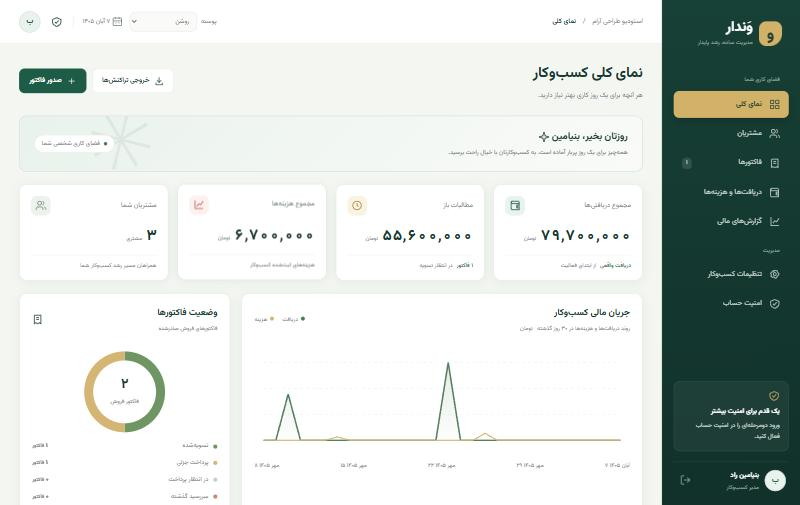
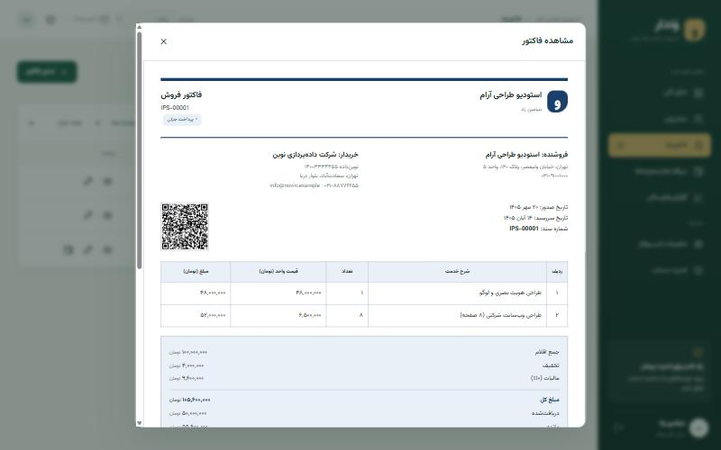

# وَندار — IPS Factor

سامانه شخصی تحت وب برای فریلنسرها، با رابط راست‌به‌چپ فارسی و فونت محلی **Vazirmatn (وزیرمتن)**. داده‌ها در فایل SQLite روی سرور خودتان ذخیره می‌شوند. برنامه برای یک مدیر و یک کسب‌وکار طراحی شده است.





## امکانات موجود

- مشتریان: مشخصات، شرکت، تماس، شناسه، نشانی، یادداشت و مانده حساب.
- فهرست خدمات و قیمت پیشنهادی؛ انتخاب خدمت هنگام صدور فاکتور، با امکان تغییر قیمت همان فاکتور و بدون تغییر اسناد قبلی.
- فاکتور فروش، پیش‌فاکتور و پیشنهاد قیمت؛ شماره‌گذاری خودکار، ردیف خدمات، تخفیف، مالیات قابل تنظیم، سررسید و پیش‌نویس.
- هشت قالب سند در دو خانواده: **رسمی** (کلاسیک، اداری، شرکتی، افقی) و **غیررسمی** (سبز مدرن، مینیمال، گرم و دوستانه، شاد)؛ با جدول کامل، چاپ و دکمهٔ دانلود مستقیم PDF با نام مشتری و تاریخ.
- پنج پوسته برای محیط کاری: روشن، شبانه، اقیانوس، کاهی و کنتراست بالا؛ انتخاب از نوار بالا یا تنظیمات، ذخیره روی همان مرورگر و پیروی خودکار از حالت تاریک سیستم در اولین اجرا. پوسته محیط، ظاهر اسناد چاپی را تغییر نمی‌دهد.
- نوشتن خودکار **مبلغ کل به حروف** روی هر سند، مطابق رسم فاکتورهای فارسی.
- **کد QR** خلاصه سند (نام کسب‌وکار، شماره، مشتری، تاریخ، مبلغ و شبا) برای تطبیق سریع نسخه چاپی.
- **رونوشت تازه** از هر سند برای کارهای تکراری و تبدیل پیش‌فاکتور به فاکتور، و پیشنهاد خودکار شرح خدمات از روی اسناد قبلی.
- بارگذاری امن لوگوی PNG/JPEG/WebP در تنظیمات کسب‌وکار و نمایش در همه قالب‌ها؛ تصویر با حذف متادیتا بازپردازش می‌شود.
- بارگذاری مهر و امضای شفاف PNG/WebP و تنظیم اندازهٔ نمایش آن روی فاکتور.
- سه طرح فارسی و متحرک برای ورود؛ ثبت توکن بازو و شناسهٔ گفت‌وگوی مقصد در تنظیمات و ارسال مستقیم PDF سند با بله.
- اعتبارسنجی شماره موبایل، نمایش اختیاری گذرواژه و پیش‌نمایش زندهٔ مبلغ با جداسازی سه‌رقمی و حروف فارسی.
- ذخیره مشخصات خریدار و فروشنده در فاکتور؛ تغییر مشخصات بعدی، اسناد قبلی را تغییر نمی‌دهد.
- دریافت کامل یا جزئی و هزینه‌ها؛ روش پرداخت و شماره پیگیری؛ جلوگیری از دریافت بیش از مانده.
- گزارش بر مبنای نقدی، بازه زمانی، تفکیک دسته‌ها، مطالبات مشتریان و سه خروجی CSV مناسب Excel: تراکنش‌ها، فاکتورها و مشتریان.
- داشبورد نموداری، نمایش تاریخ شمسی و طراحی واکنش‌گرا برای موبایل.
- ورود دومرحله‌ای TOTP، هشت کد بازیابی یک‌بارمصرف، تغییر گذرواژه و ثبت رویدادها.
- دانلود پشتیبان سازگار SQLite پس از تأیید گذرواژه.

PDF مستقیم به‌صورت تصویر با وضوح مناسب چاپ ساخته می‌شود و متن آن قابل جست‌وجو یا انتخاب نیست. برای خروجی متنی، CSV گزارش‌ها در دسترس است.

**حدود نسخه:** این برنامه حسابداری دریافت و پرداخت دارد؛ دفتر کل دوطرفه، موجودی انبار، درگاه پرداخت، ارسال پیامک/ایمیل و اتصال سامانه مؤدیان پیاده نشده‌اند. اسناد، صورتحساب الکترونیکی مالیاتی محسوب نمی‌شوند. مبالغ صحیح به تومان و تعداد اقلام عدد صحیح‌اند. تاریخ‌ها شمسی نمایش داده می‌شوند؛ ورودی تاریخ و تقویم انتخاب روز نیز کاملاً شمسی‌اند و ارقام فارسی، عربی و انگلیسی را می‌پذیرند. نرخ مالیات را متناسب با فعالیت خودتان تنظیم کنید؛ پیش‌فرض صفر است.

## بستهٔ پرتابل ویندوز

برای ساخت نسخهٔ پرتابل ویندوز ۶۴ بیتی روی رایانه‌ای که Node.js 24.21.0 و .NET Framework 4 دارد، `node scripts/build-portable.mjs` را اجرا کنید. پوشه و فایل ZIP در `dist/` ساخته می‌شوند. بسته شامل Node.js، همهٔ وابستگی‌ها و یک نسخهٔ سازگار از پایگاه داده و کلید رمزگذاری فعلی است. پس از انتقال، روی `Vandar.exe` دوبار کلیک کنید؛ برنامه بدون پنجره کنار ساعت ویندوز اجرا می‌شود و از همان‌جا می‌توانید صفحه را باز کنید، کد راه‌اندازی را کپی کنید و برنامه را ببندید. برای اجرا نیازی به نصب Node.js یا اینترنت نیست. کل پوشه را با هم جابه‌جا کنید و فایل ZIP را مانند دادهٔ مالی خصوصی نگه دارید.

برای ساخت بستهٔ بدون داده و انتشار کد و Release در GitHub، [راهنمای انتشار](docs/GITHUB_RELEASE.md) و `scripts/publish-release.ps1` را ببینید.

نصب اختیاری سرویس ویندوز از داخل بسته با `Install-Service.ps1` انجام می‌شود. ابتدا حساب مدیر را با `Vandar.exe` بسازید و برنامه را ببندید، سپس اسکریپت را در PowerShell مدیر اجرا کنید. سرویس هنگام شروع ویندوز فعال می‌شود و میانبر دسکتاپ، برنامه را در نمای تمام‌صفحه Edge یا Chrome باز می‌کند. جزئیات و روش حذف سرویس در `راهنما.txt` داخل بسته آمده است.

## نصب‌کنندهٔ یک‌فایلی ویندوز

برای ساخت `Vandar-Setup-v1.1.0-win-x64.exe`، دستور `npm run build:setup` را روی ویندوز ۶۴ بیتی اجرا کنید. فایل Setup بستهٔ پاکِ بدون داده را در خود دارد و با دسترسی Administrator سرویس را نصب و اجرا می‌کند، آیکن وَندار را روی میانبر دسکتاپ می‌گذارد و کد راه‌اندازی نخستین اجرا را نشان می‌دهد. نصب دوبارهٔ Setup روی همان رایانه، فایل‌های برنامه را به‌روزرسانی می‌کند و پوشهٔ `data` را حفظ می‌کند. برای حذف سرویس از `Uninstall-Service.ps1` استفاده کنید؛ داده‌ها تا زمان حذف دستی باقی می‌مانند.

آیکن جدید در تب مرورگر، رابط برنامه، فایل‌های اجرایی، آیکن کنار ساعت، میانبر دسکتاپ و نصب‌کننده به کار رفته است. بستهٔ قابل انتشار به Node.js یا اینترنت در رایانهٔ مقصد نیاز ندارد؛ Windows 10/11، .NET Framework 4.5 یا جدیدتر، PowerShell و Edge یا Chrome لازم است.

## اجرای محلی

نیازمند Node.js نسخه ۲۴ یا جدیدتر:

```sh
npm ci
npm start
```

نشانی: http://localhost:3000

در اجرای اول، ترمینال مقدار `First-run setup token` را چاپ می‌کند. آن را در فرم راه‌اندازی بنویسید و نام، ایمیل و گذرواژه خود را تعیین کنید. هیچ گذرواژه یا حساب پیش‌فرضی وجود ندارد. کد با هر راه‌اندازی سرور قبل از ایجاد حساب عوض می‌شود و پس از ایجاد حساب دیگر معتبر نیست. برای خروجی کد در Docker، از `docker compose logs app` استفاده کنید.

بعد از ورود:

1. در «تنظیمات کسب‌وکار» نام و اطلاعات پرداخت خود را ثبت کنید.
2. در «امنیت حساب»، ورود دومرحله‌ای را فعال و کدهای بازیابی را خارج از سرور ذخیره کنید.
3. مشتری ثبت کنید؛ خدمات پرتکرار را با قیمت پیشنهادی ذخیره کنید و سپس فاکتور صادر کنید.
4. پرداخت مشتری را از ردیف همان فاکتور ثبت کنید؛ دریافت مستقل، بدهی هیچ فاکتوری را تسویه نمی‌کند.

داده‌های اصلی در `data/` ایجاد می‌شوند؛ این پوشه وارد Git یا ایمیج Docker نمی‌شود. داده نمونه به پایگاه اصلی اضافه نشده است.

## چه هاستی بخریم؟

پیشنهاد شروع برای یک فریلنسر با چند هزار رکورد: **سرور مجازی لینوکسی (VPS) با Ubuntu 24.04 LTS، معماری x86_64، دو هسته پردازنده، ۲ گیگابایت RAM، ۲۰ تا ۳۰ گیگابایت SSD، IPv4 ثابت، دسترسی root/SSH و پشتیبانی Docker Compose**. این مشخصات برآورد ظرفیت اولیه‌اند، نه نتیجه تست بار. دامنه یا زیردامنه هم لازم است. MySQL و لایسنس cPanel نیاز نیست؛ SQLite داخل برنامه است.

اگر تجربه مدیریت لینوکس ندارید، «VPS مدیریت‌شده» بخواهید و از فروشنده تأیید بگیرید که نصب Docker Compose، reverse proxy، HTTPS، به‌روزرسانی سیستم و پشتیبان خارج از سرور را پشتیبانی می‌کند. فضای پشتیبان را جدا از دیسک اصلی تهیه کنید. دسترسی شبکه سرور به مخازن Docker/npm و صادرکننده گواهی TLS باید برقرار باشد.

متن قابل ارسال به فروشنده:

> یک VPS لینوکسی Ubuntu 24.04 LTS با ۲ vCPU، رم ۲GB، دیسک SSD حداقل ۲۵GB، IPv4 ثابت و دسترسی root می‌خواهم؛ برای اجرای Node.js 24 و SQLite داخل Docker Compose، با دامنه شخصی، HTTPS و پورت‌های ورودی ۸۰ و ۴۴۳. آیا اجرای دائمی کانتینرها و تهیه پشتیبان خارج از سرور را پشتیبانی می‌کنید؟

Ubuntu 24.04 در [فهرست رسمی سیستم‌های پشتیبانی‌شده Docker](https://docs.docker.com/engine/install/ubuntu/) است. هاست اشتراکی PHP/WordPress گزینه مناسب این پروژه نیست. هاست Node.js فقط در صورت پشتیبانی صریح از Node 24، دیسک دائمی قابل نوشتن برای SQLite، فرآیند دائمی، وابستگی native بسته sharp و reverse proxy امن قابل استفاده است؛ روش آماده پروژه VPS و Docker است.

## نصب روی دامنه شخصی با Docker

این روش به **سرور لینوکسی دارای Docker Compose** احتیاج دارد؛ هاست اشتراکی صرفاً PHP مناسب این پیاده‌سازی نیست. هنوز سرور یا دامنه‌ای از طرف شما خریداری یا تنظیم نشده است.

1. رکورد DNS دامنه یا زیردامنه را به IP سرور وصل کنید. اگر رکورد IPv6 دارید، آن هم باید به سرور صحیح اشاره کند.
2. فایل‌های پروژه را به سرور منتقل کنید، `.env.example` را به `.env` کپی کنید و مقدار `DOMAIN` را بدون `https://` و مسیر تنظیم کنید:

```env
DOMAIN=factor.example.com
```

3. پورت‌های TCP ۸۰ و ۴۴۳ را باز کنید و اجرا کنید:

```sh
docker compose up -d --build
docker compose logs app
```

4. `https://factor.example.com` را باز و حساب مدیر را با کد خروجی لاگ بسازید. Caddy پس از تنظیم صحیح DNS و دسترسی شبکه، گواهی HTTPS را خودکار دریافت می‌کند. پورت برنامه مستقیماً منتشر نمی‌شود.

برای به‌روزرسانی، فایل‌ها را جایگزین و همان دستور `docker compose up -d --build` را اجرا کنید. قبل از به‌روزرسانی نسخه پایگاه داده، پشتیبان کامل بگیرید. از `docker compose down -v` استفاده نکنید؛ گزینه `-v` داده‌های volume را حذف می‌کند.

### اجرای بدون Docker

`npm ci --omit=dev` و Node ۲۴، یک سرویس پایدار مثل systemd، و reverse proxy دارای HTTPS لازم است. تنظیمات محیط:

| متغیر | مقدار |
| --- | --- |
| `NODE_ENV` | `production` |
| `PUBLIC_ORIGIN` | نشانی دقیق HTTPS، بدون اسلش آخر؛ مثلاً `https://factor.example.com` |
| `HOST` | برای proxy محلی `127.0.0.1`؛ در شبکه خصوصی کانتینر `0.0.0.0` |
| `PORT` | پیش‌فرض `3000` |
| `DATA_DIR` | مسیر مطلق پوشه داده با دسترسی نوشتن برای کاربر سرویس |
| `TRUST_PROXY` | فقط وقتی یک reverse proxy مورد اعتماد جلوی برنامه است، `1` |

خود برنامه در حالت production بدون `PUBLIC_ORIGIN` دارای HTTPS اجرا نمی‌شود. دسترسی مستقیم به پورت پشت proxy باید بسته باشد تا هدر IP قابل جعل نباشد. `DATA_DIR` را داخل پوشه public یا مسیر سرو فایل‌ها قرار ندهید. فایل‌های فونت محلی‌اند؛ CDN یا سرویس بیرونی برای کارکرد رابط لازم نیست.

## پشتیبان‌گیری و بازیابی

پایگاه داده شامل اطلاعات خصوصی مشتریان و اطلاعات ورود است. نسخه‌ها را در فضای رمزگذاری‌شده خارج از سرور، با دسترسی محدود نگه دارید.

برای پشتیبان پایگاه داده از «امنیت حساب ← دریافت پشتیبان» استفاده کنید. این خروجی snapshot سازگار با WAL است؛ کپی مستقیم فایل SQLite از سرویس روشن روش پشتیبان‌گیری این برنامه نیست.

**فایل `encryption.key` برای بازیابی کلیدهای دومرحله‌ای ضروری است.** پشتیبان دانلودشده آن را شامل نمی‌شود. یک بار و بعد از هر تعویض کلید، این فایل را جداگانه و محرمانه نگه دارید. برای تهیه پشتیبان کامل volume با توقف کوتاه:

```sh
docker compose stop app
docker compose cp app:/app/data ./private-backup
docker compose start app
```

پوشه `private-backup` را بیرون از مسیر وب، با دسترسی محدود و رمزگذاری ذخیره کنید. این پوشه را به Git اضافه نکنید.

بازیابی را ابتدا روی یک نمونه جدا امتحان کنید:

1. سرویس برنامه را متوقف کنید و از داده فعلی نسخه نگه دارید.
2. محتوای پوشه داده را با **مجموعه کامل همان پشتیبان** جایگزین کنید. در بازیابی فایل دانلودی، آن را `accounting.sqlite` نام بگذارید و `encryption.key` متناظر را کنار آن قرار دهید. فایل‌های WAL/SHM متعلق به پایگاه قبلی را با پایگاه جدید مخلوط نکنید.
3. مالکیت پوشه را به کاربر سرویس برگردانید (کاربر `node` در ایمیج).
4. از ابزار بازیابی مدیر زیر برای تغییر گذرواژه و لغو همه نشست‌های پشتیبان استفاده کنید؛ سپس سرویس را اجرا و مشتریان، فاکتورها و ورود دومرحله‌ای را بررسی کنید.

نبود فایل کلید در کنار پایگاه داده موجود باعث توقف برنامه می‌شود، تا کلید جدیدی به‌اشتباه جایگزین کلید قبلی نشود.

## فراموشی گذرواژه یا از دست رفتن برنامه احراز هویت

بازیابی از طریق ایمیل وجود ندارد. با دسترسی مستقیم به ترمینال سرور:

```sh
node scripts/recover-admin.js
```

در Docker:

```sh
docker compose exec app node scripts/recover-admin.js
```

ابزار گذرواژه را بدون نمایش درخواست می‌کند و تمام نشست‌ها را لغو می‌کند. ورود دومرحله‌ای فعال می‌ماند. اگر هم برنامه احراز هویت و هم تمام کدهای بازیابی از دست رفته‌اند، مدیر سرور باید صریحاً گزینه `--disable-2fa` را اضافه کند و بلافاصله پس از ورود، دومرحله‌ای را دوباره فعال کند. این ابزار HTTP endpoint ندارد.

## آزمون و امنیت

```sh
npm test
npm audit --omit=dev
```

آزمون‌های یکپارچه روی پایگاه موقت اجرا می‌شوند و داده اصلی را تغییر نمی‌دهند. آن‌ها ورود و راه‌اندازی، CSRF و مبدأ، SQL پارامتری، محاسبه مالی، اعتبار تاریخ، هم‌زمانی ویرایش، پرداخت جزئی، جلوگیری از پرداخت اضافی، نگهداری مشخصات سند، پشتیبان، TOTP رمزگذاری‌شده، جلوگیری از بازپخش کد، بازیابی یک‌بارمصرف، محدودسازی ورود، تبدیل تاریخ شمسی و نوشتن مبلغ به حروف را بررسی می‌کنند. همین آزمون‌ها با هر push و pull request روی GitHub Actions هم اجرا می‌شوند.

کنترل‌های پیاده‌شده: گذرواژه scrypt با نمک تصادفی، نشست تصادفی با نگهداری هش در دیتابیس، انقضای هشت‌ساعته و کوکی HttpOnly/SameSite=Strict/Secure در production، چرخش نشست هنگام ورود، اعتبارسنجی سمت سرور، تراکنش پایگاه داده برای عملیات مالی، محافظت CSRF و بررسی Origin، محدودسازی نرخ، CSP و سایر هدرهای Helmet، escape خروجی HTML، محافظت فرمول CSV، و رمزگذاری AES-256-GCM کلید TOTP.

**تست نفوذ مستقل و استقرار واقعی Docker/HTTPS روی دامنه شما انجام نشده است.** امنیت میزبان، به‌روزرسانی سیستم و وابستگی‌ها، فایروال، نگهداری کلید و آزمون دوره‌ای بازیابی مسئولیت مدیر سرور است. داده‌های عادی دیتابیس رمزگذاری در سطح فیلد ندارند؛ برای رمزگذاری دیسک و نسخه پشتیبان از امکانات میزبان استفاده کنید.

## ساختار

```text
server.js                 API، امنیت و SQLite
public/style.css          پوسته‌های محیط و قالب‌های سند، همه بر پایه متغیرهای CSS
public/app.js             رابط فارسی، نمودارها و قالب چاپ
public/persian-date.js    تبدیل و تقویم شمسی
public/persian-number.js  نوشتن مبلغ به حروف فارسی
scripts/recover-admin.js  بازیابی آفلاین مدیر
test/                     آزمون‌های یکپارچه، تاریخ شمسی و مبلغ به حروف
.github/workflows/ci.yml  اجرای خودکار آزمون‌ها روی Node 24
compose.yaml / Caddyfile  استقرار با HTTPS
data/                     داده محلی؛ خارج از Git
```

افزودن پوسته تازه برای محیط، یعنی یک بلوک `html[data-theme=نام]` در `public/style.css` و یک سطر در `uiThemes` داخل `public/app.js`؛ افزودن قالب تازه برای سند، یعنی یک کلاس `.invoice-preview.نام`، یک سطر در `templates` و همان نام در `invoiceTemplates` داخل `server.js`.

## مجوز

کد پروژه با مجوز MIT منتشر می‌شود؛ متن کامل در فایل [LICENSE](LICENSE) است. مجوز فونت وزیرمتن در پکیج `vazirmatn` نگهداری شده و فونت با مجوز OFL ارائه می‌شود.
